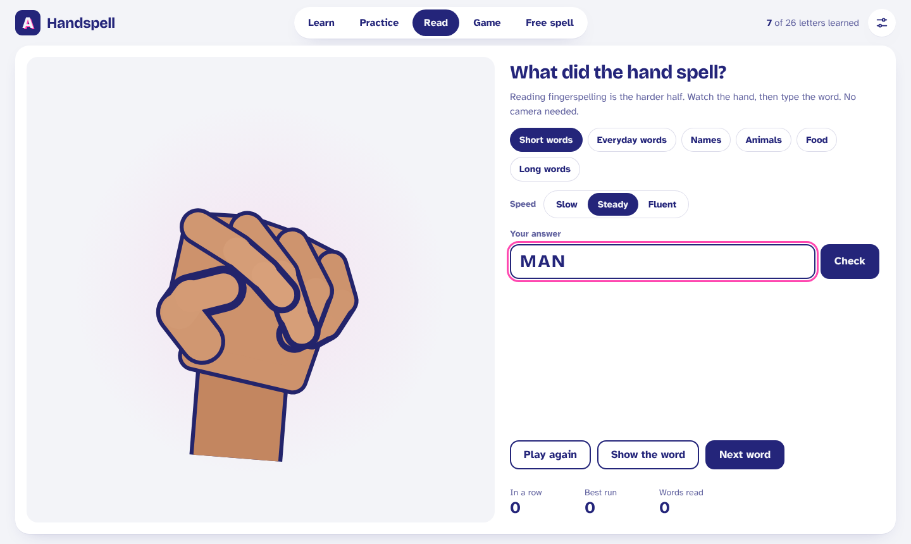
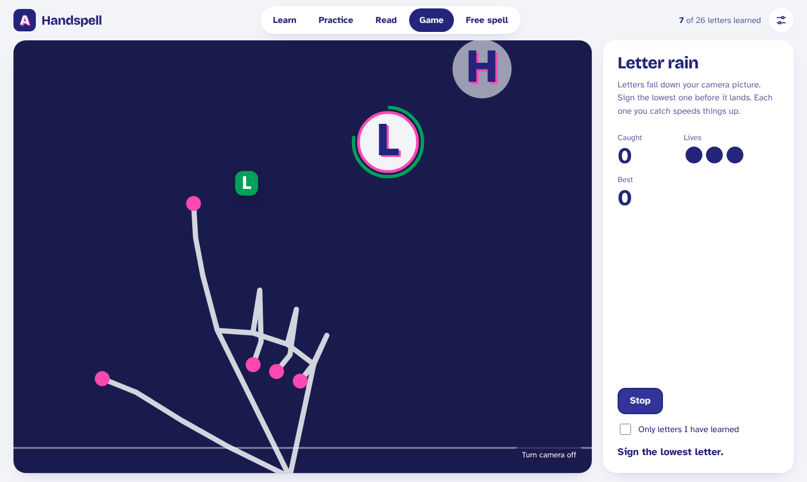
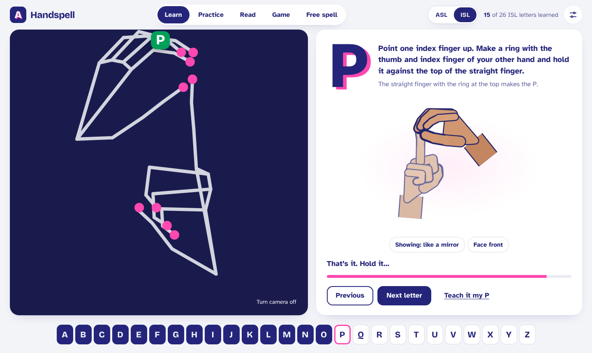
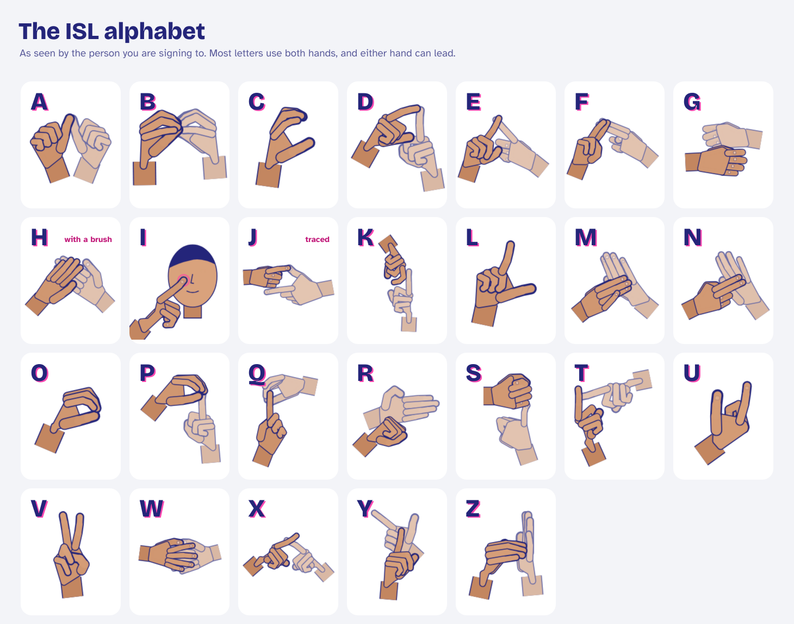
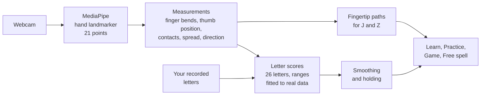

# Handspell

**Learn to fingerspell in ASL or ISL with your webcam.** A 3D hand shows you each letter. Your camera checks your handshape as you sign, and tells you what to change when it isn't right yet.


Fingerspelling is how signers spell names, places and words that have no sign of their own. It is usually the first thing people learn in a sign language, and the hardest thing to practise alone: a chart can't tell you that your thumb is in the wrong place. Handspell can. It teaches two alphabets: American Sign Language (ASL), spelled with one hand, and Indian Sign Language (ISL), where most letters use both. It runs entirely in your browser, with no install, no account and no server, and the video never leaves your device.

[Quick start](#quick-start) · [Features](#features) · [Indian Sign Language](#indian-sign-language) · [How it works](#how-it-works) · [Accuracy](#accuracy) · [Data and credits](#data-and-credits)

## Features

**Two alphabets.** Switch between **ASL** and **ISL** at the top of the page. Each keeps its own progress and recorded letters. A link ending in `?alphabet=isl` opens straight into ISL.

**Five ways to practise**
- **Learn:** all 26 letters, one at a time.
  - A 3D reference hand shows each shape. Drag it (or use the arrow keys) to see it from any side, and view it like a mirror or as others see you.
  - The camera checks your hand live. When the shape is off, it says what looks wrong in plain words, for example *"That looks like S. Move your thumb back towards your index finger."*
  - In ASL, J and Z are recognised by their movement, drawn in the air.
- **Practice:** spell whole words, letter by letter.
  - Seven word lists: short words, everyday words, names, animals, food, places in India and long words.
  - Double letters work like real fingerspelling: slide your hand a little to the side for the second one.
  - Shows your speed in letters per minute.
- **Read:** the hand fingerspells a word and you type what you saw, at slow, steady or fluent speed. Reading fingerspelling is the harder half of the skill, and this mode needs no camera.
- **Letter rain:** letters fall down your camera picture. Sign the lowest one before it lands, and the more you catch, the faster they fall.
- **Free spell:** sign anything and watch it appear as text. Lower your hand for a space, and press *Say it* to hear it read aloud.

**Made to fit you**
- **Teach it my letter** records your own version of any letter, so the recogniser learns your hand. For ISL, a two-minute setup records your whole alphabet in one go.
- **Right or left hand:** everything flips for left-handed signers.
- **Settings for the reference hand and the checking:**
  - Five skin tones for the reference hand, or a white glove.
  - Relaxed, normal or strict checking.
  - Short, medium or long holds.
- **Progress:** learned letters, best speeds, game scores and days in a row, all saved in your browser.
- **Accessible:**
  - Everything works with the keyboard.
  - Animations respect *reduce motion*.
  - Text is set in Atkinson Hyperlegible, a typeface designed by the Braille Institute for legibility.

<table>
  <tr>
    <td><br><b>Practice.</b> Spell words letter by letter.</td>
    <td><br><b>Read.</b> Watch the hand, type the word.</td>
  </tr>
  <tr>
    <td><br><b>Letter rain.</b> Sign the lowest letter before it lands.</td>
    <td><br><b>The whole alphabet,</b> drawn by Handspell's reference hand.</td>
  </tr>
</table>

<sub>In these screenshots the camera picture is left out and the hand outline comes from recorded landmark data, so they look the same for everyone. In the app you see yourself.</sub>

## Indian Sign Language

ISL fingerspelling is mostly two-handed: one hand touches, rests on or hooks into the other. C, I, L, O, U and V use one hand, and I points to your own face. Handspell tracks both hands, measures how they touch, and looks for your face for I.



- **Every letter drawn with both hands,** from real photos of ISL signers, including a face for I. The hand behind is drawn paler, so the two hands read apart where they overlap. The drawing turns, and shows the movement for H and J.
- **Either hand can lead.** Each camera picture is checked both ways round.
- **Teach Handspell your ISL alphabet.** Signers make some ISL letters differently, and the public photo collections only show a few dozen people. A guided setup records your own version of every letter in about two minutes. On high-resolution photos of people it had never seen, three of their own examples per letter lifted the exact letter from 59% to 89% (see [Accuracy](#accuracy)).
- **It keeps learning.** Every letter you sign right in Learn or Practice is kept as one more example of your hands, so recognition adapts to your camera and light as you go. If a letter still isn't recognised after a few tries, Learn suggests recording your version.
- **Advice that talks about contact:** *"Touch the tips of your two thumbs together"*, *"Lay three fingers across your open palm"*, *"This letter uses both hands. Show both to the camera."*

<table>
  <tr>
    <td><br><b>Setup.</b> Sign each letter once while Handspell watches.</td>
    <td><br><b>The ISL alphabet,</b> as Handspell draws it.</td>
  </tr>
</table>

The letters follow the chart from the [Indian Sign Language Research and Training Centre](https://islrtc.nic.in/) and the signers in the photo collections. They have not yet been reviewed by a Deaf ISL signer or teacher. If you sign ISL and something looks wrong, please [open an issue](../../issues).

## Quick start

Handspell is a static site: plain HTML, CSS and JavaScript modules. There is nothing to build.

```bash
# in the project folder
python3 -m http.server 8000      # or: npm start
```

Open **http://localhost:8000** in Chrome, Edge, Firefox or Safari, choose **Turn on camera** and allow access. The first time, the browser downloads the hand-tracking library and model (about 20 MB). After that it comes from the cache.

Opening `index.html` directly from disk will not work, because browsers only allow the camera on `localhost` or HTTPS.

**Put it online:** import the repository into Vercel or Netlify with no build command and the root folder as the output, or turn on GitHub Pages for the `main` branch. All three serve over HTTPS, which the camera needs.

### Tips for good recognition

- Sit an arm's length from the camera with your hand at chest height, palm towards the camera.
- Light your hand from the front. A window behind you turns it into a silhouette.
- Hold each shape still for half a second; the bar under the advice fills while you hold.
- For a letter that never seems to pass, use **Teach it my letter** in Learn. It records a few examples of your version.

## How it works



1. **Tracking.** Google's MediaPipe hand landmarker finds 21 points on your hand in each video frame, on your device, using the GPU where it can.
2. **Measurements** (`src/sign/features.js`). The points are turned into about 25 numbers that describe the handshape in the hand's own frame, so the hand's position, its size on screen and which hand you use don't matter. They include:
   - how bent each finger is;
   - where the thumb sits across the fingers, and whether it is in front of them or tucked under;
   - which fingertips touch;
   - how far the fingers spread, and whether they cross;
   - which way the hand points.

   MediaPipe sometimes mistakes a left hand for a right one when the hand is side-on. Fingers only curl towards the palm, so the direction they bend reveals which side the palm is really on, and the measurements correct themselves.
3. **Letters** (`src/sign/letters.js`, `recognizer.js`).
   - Every letter is described by the same set of measurements, with extra weight on the ones that define it: the thumb position for A and S, finger crossing for R, the direction of the hand for G, H, P and Q.
   - Some letters have two variants, because people make them differently. M and N, for example, are signed with the fingers draped forward over the thumb, or curled into a fist.
   - The acceptable range of every measurement was fitted to real landmark data from three public collections with at least seven signers (see [Accuracy](#accuracy)).
   - A hand scores each letter by how well it fits those ranges. When it misses, the measurement that is furthest off becomes the advice you see (`hints.js`).
4. **Over time** (`src/sign/live.js`, `motion.js`).
   - Scores are smoothed over a few frames, and a letter counts once it has been held.
   - J and Z follow the little finger or index fingertip and look for the shape of the letter in its path.
   - In Practice and Free spell, a repeated letter needs a small slide or release, as in real fingerspelling.
5. **Your letters.** *Teach it my letter* stores a few measurements of your own handshape. A close match to one of them lifts that letter's score.
6. **The reference hand** (`src/hand3d`). Each letter's shape is the median of hundreds of real landmark sets. It is rotated so the letter reads clearly, and drawn with outlined, depth-sorted strokes on a canvas, with no 3D library. Between letters, the hand eases from one shape to the next, which is how Read mode fingerspells whole words.

### ISL

ISL uses a different recogniser (`src/sign/isl`), loaded the first time you choose ISL:

1. **Two hands** (`features.js`). With both hands in view, it measures how they relate: the distance between every pair of fingertips, fingertips on the other palm, crossed fingers, fists stacked one above the other, and the shape of each hand. Distances are in palm lengths.
2. **Matching examples** (`matcher.js`, `examples.js`). The measurements are compared with about 3,400 example handshapes from three public ISL photo collections, at most 60 per letter from each, so that no collection's few signers dominate. The closest examples vote, and contacts count more than anything else. Your own recorded letters are blended in letter by letter and count for more, because they are your hands and your camera.
3. **Both ways round** (`live.js`). Each picture is measured as seen and mirrored, and every letter keeps its better score, so either hand can lead. MediaPipe's left and right labels are not used for this, because they flip when the back of the hand faces the camera.
4. **One hand or two.** Two hands that touch are hard to track, so in ISL the tracker looks harder for a second hand. If one of two hands vanishes for a moment while the other stays put, it is assumed to be where it was for up to half a second. A two-hand letter can still be recognised from one hand, but less readily, and while you are asked for a two-hand letter with only one hand in view, Handspell says so instead of guessing.
5. **The face, for I** (`src/tracking/face.js`). MediaPipe's small face detector runs on every third frame. A fingertip just under an eye settles I.
6. **The drawing** (`src/hand3d/isl-poses.js`, made by `tools/isl-poses.py`). For each letter, a clear, typical photo was chosen by eye from the most typical ones in the collections. An anatomical hand model (fixed bone lengths, joints that only bend the way fingers do) is fitted to each hand's landmarks, which gives clean shapes even where a finger was hidden. Near-contacts are closed, letters built on an upright index finger (D, K, P, Q, T) are turned so it stands straight, and both hands are drawn in one frame.

### Project structure

```
├── index.html, styles.css
├── src/
│   ├── main.js                camera, main loop, settings, mode switching
│   ├── tracking/              MediaPipe hand landmarker, and the face detector (ISL I)
│   ├── sign/                  ASL: measurements, letter definitions, fitted ranges,
│   │   │                      recogniser, advice, J and Z movements, live pipeline
│   │   └── isl/               ISL: two-hand measurements, letters and advice, example
│   │                          handshapes, matcher, live pipeline
│   ├── hand3d/                reference poses (ASL and ISL), the hand renderer, the stage
│   ├── modes/                 learn, practice, read, game, free spell
│   ├── data/words.js          word lists
│   └── ui/                    saved settings and progress, sounds
├── tools/                     data preparation, fitting, evaluation, poses, charts
└── docs/images/               screenshots
```

## Accuracy

The ranges were fitted with each data collection weighted equally, then tested on signers who were left out of the fitting. These numbers are for single photos. In the app a letter is judged over several frames and has to be held, which helps.

| Test, on signers not used for fitting | Exact letter | In the top three | Right letter accepted | Closest wrong letter accepted |
| --- | --- | --- | --- | --- |
| ASL Alphabet Test photos (706 photos) | 83% | 97% | 84% | 16% |
| Surrey signers D and E (23,167 frames) | 59% | 86% | 62% | 44% |

The "accepted" columns use the normal checking level. The Surrey frames are low-resolution, with hands about 100 pixels across, so their landmarks are noisy. A webcam hand is usually several times larger, so the first row is closer to what to expect.

The hardest letters are the closed-fist group (A, E, M, N, S and T), where the thumb is partly hidden, and P and Q, which point down and are seen end-on. For comparison, the neural network in the paper the data comes from reaches about 89% on the same test photos.

To reproduce these numbers or improve the letters:

```bash
git clone --depth 1 https://github.com/rameshponnala-blip/Hand-Landmark
python3 tools/prepare-data.py Hand-Landmark/data/landmarks     # needs pandas
HOLDOUT=T,D,E node tools/tune.mjs && HOLDOUT=D,E node tools/evaluate.mjs
node tools/tune.mjs        # fit on everything again (what ships)
node tools/poses.mjs       # rebuild the reference hand shapes
```

`tools/alphabet-chart.html`, served locally, redraws the alphabet chart above.

### ISL

The ISL matcher was tested on signers it had never seen: example handshapes from two of the three collections, tested on the third. Then a few photos of each letter from the test collection were added as "own examples", and the rest were tested.

| Tested on | No own examples | 1 per letter | 3 per letter | 5 per letter |
| --- | --- | --- | --- | --- |
| Mendeley: 4 signers, 1280-pixel photos (452) | 59% (76%) | 76% (91%) | 89% (95%) | 94% (97%) |
| RealSign: 4 signers, small photos (5,224) | 51% (71%) | 58% (73%) | 72% (84%) | 79% (89%) |

Exact letter, with the share in the top three in brackets. The third collection (100-pixel photos of many signers) scores 36% (50%) without own examples. Its photos are too small for clean landmarks, and its "own examples" come from a mix of different people, so they help little there.

These are single photos; in the app a letter is judged over several frames and must be held. Own examples help most when they are really yours: in the first row they came from the same four people, but mixed together. A webcam picture of your hands is closest to the first row.

The photos showed where recognition fails without setup:

- **One hand lost.** With both hands seen, A was recognised in all of the Mendeley photos and 93% of the RealSign ones. When the tracker found only one of the two fists, it was usually mistaken for a one-hand letter (I, S or T). This is why the tracker now looks harder for a second hand and holds on to a hand lost for a moment.
- **Letters against an open palm** (H, M, N, R and W) are mixed up with each other, as are E and K (both fingertip contacts) and G and A (both fists).

Training a different kind of model on the same measurements (boosted trees, a small neural network) gained at most five points, so the limit is how differently people sign and how few signers the collections have, not the matching method.

To rebuild the ISL data, download [RealSign](https://github.com/RealSign62/RealSign-Indian-Sign-Language-Dataset), the [multimodal ISL dataset](https://doi.org/10.17632/2tj6c7pzfk.2) and the [ISL image dataset](https://github.com/ayesha-hannure/Indian-Sign-Language-dataset), then:

```bash
pip install mediapipe numpy scipy pillow
python3 tools/isl-extract.py RealSign/Training tools/data/isl/realsign-train.jsonl --model hand_landmarker.task
python3 tools/isl-extract.py RealSign/Testing tools/data/isl/realsign-test.jsonl --model hand_landmarker.task
python3 tools/isl-extract.py Mendeley/Dataset/English/RGB tools/data/isl/mendeley.jsonl --model hand_landmarker.task
python3 tools/isl-extract.py dataset_ISL tools/data/isl/ayesha.jsonl --model hand_landmarker.task --upscale 320
node tools/isl-build.mjs      # writes src/sign/isl/examples.js
python3 tools/isl-poses.py    # writes src/hand3d/isl-poses.js
```

The ISL image dataset's folders are lower-case letters; rename them to capitals first.

`tools/isl-chart.html`, served locally, redraws the ISL chart. For the Mendeley collection, leave out the images its `manifest.csv` marks as padded duplicates.

## About fingerspelling and ASL

Fingerspelling is a small part of American Sign Language, which is a full language with its own grammar, and most words have their own signs. Handspell is a practice tool for the manual alphabet. It does not translate sign language, and it is no substitute for learning from Deaf teachers and the Deaf community.

The same is true of Indian Sign Language, which is not a form of ASL or of signed English. Other sign languages have their own alphabets, too. British and Australian sign languages, for example, also use two hands. Handspell teaches the ASL and ISL alphabets.

## Privacy

The camera picture is processed inside your browser tab and is never recorded or sent anywhere. In ISL, a face detector also runs in the tab, only to find your eyes for the letter I. The only network requests are for the app's own files: the MediaPipe library and models (from jsDelivr and Google), and the fonts (from Google Fonts). Your settings, progress and recorded letters stay in your browser's local storage. **Reset my progress** and **Forget my recorded letters** in Settings clear them.

## Roadmap

- [x] Indian Sign Language (ISL) alphabet, which uses two hands
- [ ] Review of the ISL letters and advice by Deaf ISL signers
- [ ] Numbers 0 to 10, in ASL and ISL
- [ ] A printable alphabet chart from the app
- [ ] Installable offline app (PWA)
- [ ] More word lists, and word lists in other languages that use the Latin alphabet

## Contributing

Contributions are welcome, especially:
- word lists;
- better advice wording;
- improvements to the hard letters, checked with `tools/evaluate.mjs`;
- feedback from signers and teachers, in ASL and in ISL.

Please open an issue first for larger changes. The code is plain ES modules with no build step and no dependencies.

## Data and credits

- **Landmark data.** The letter ranges and the reference hand shapes were fitted to MediaPipe hand landmarks published by R. Ponnala and Md. Kaleem with their paper *Hand-Landmark Recognition of ASL Fingerspelling: How Well Does It Generalize, and When Should It Abstain?* ([repository](https://github.com/rameshponnala-blip/Hand-Landmark), MIT license). Their landmarks were extracted from three public image collections:
  - *ASL Alphabet* by A. Nagaraj (Kaggle, 2018);
  - *ASL Alphabet Test* by D. Rasband (Kaggle, 2018);
  - the *Surrey ASL Fingerspelling Dataset A* by N. Pugeault and R. Bowden ("Spelling it out", ICCV Workshops 2011).

  Handspell contains only numbers derived from those landmarks (value ranges and median hand shapes), not the images or the landmark files. If you reuse the data, please check the terms of each collection.
- **ISL data.** The ISL example handshapes and reference poses come from MediaPipe landmarks that Handspell extracted from three openly licensed photo collections:
  - *RealSign: An Open-Source Indian Sign Language Database* by Aaptha Boggaram, Ankith Boggaram, Ashwin Srinivasa Ramanujan, Aryan Sharma and Bharathi R ([repository](https://github.com/RealSign62/RealSign-Indian-Sign-Language-Dataset), CC0 1.0);
  - *A Multimodal Indian Sign Language Dataset for English and Marathi Alphabet Signs and Numerical Digits with Pose and Skin Segmentation Representations* by Hambir, Khandagale, Cherian, Gaikwad and colleagues at the Vishwakarma Institute of Information Technology, Pune (Mendeley Data, [doi:10.17632/2tj6c7pzfk.2](https://doi.org/10.17632/2tj6c7pzfk.2), CC BY 4.0);
  - the *Indian Sign Language Image Dataset* by Ayesha Hannure, Esha Gavali, Shivani Kamtikar and Urvi Lendhe, with images contributed by Leela Surya Teja Mangamuri and others ([repository](https://github.com/ayesha-hannure/Indian-Sign-Language-dataset), Apache License 2.0). The reference poses don't use it.

  As with ASL, Handspell contains only numbers derived from the landmarks, not the photos. The letter descriptions follow the English alphabet chart from the [Indian Sign Language Research and Training Centre](https://islrtc.nic.in/) (ISLRTC), which is linked here and not copied.
- **Hand and face tracking:** [MediaPipe Tasks Vision](https://www.npmjs.com/package/@mediapipe/tasks-vision) and its hand landmarker and BlazeFace face detector models (Apache 2.0).
- **Fonts:** [Bricolage Grotesque](https://fonts.google.com/specimen/Bricolage+Grotesque) and [Atkinson Hyperlegible](https://fonts.google.com/specimen/Atkinson+Hyperlegible), both under the SIL Open Font License.

## License

[MIT](LICENSE) © 2026 khjabir
