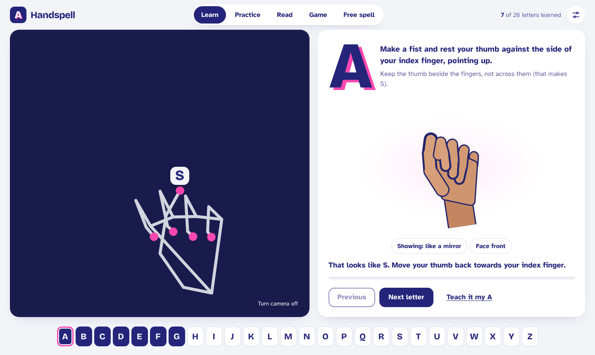
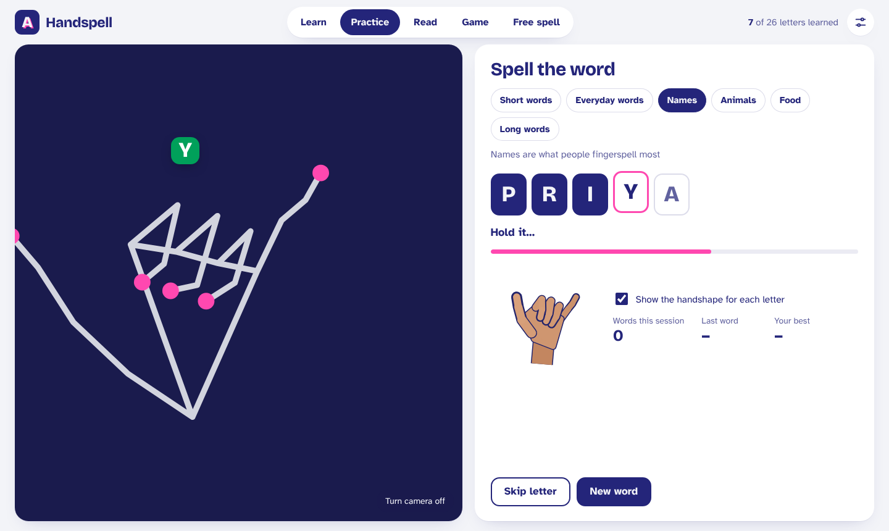
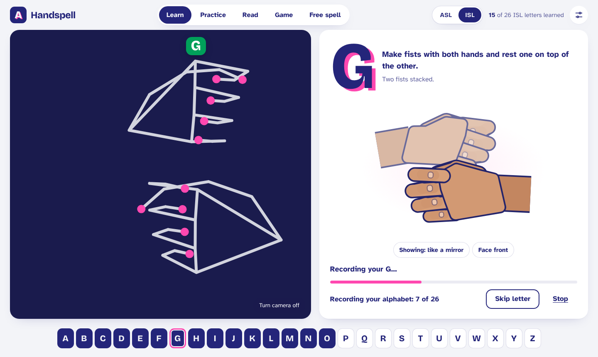
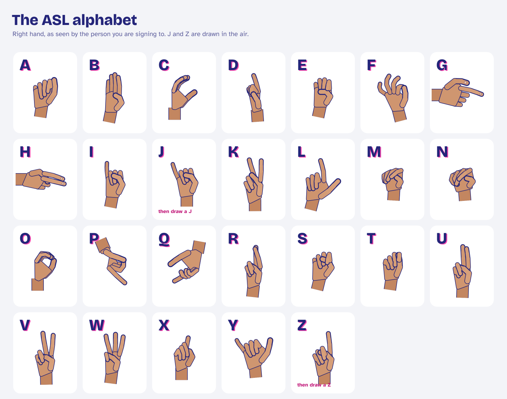
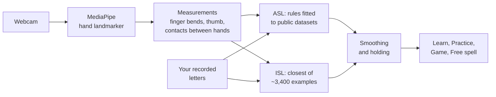

<div align="center">

# Handspell

**Learn to fingerspell in American (ASL) or Indian (ISL) Sign Language with your webcam.**

A 3D hand shows you each letter. Your camera checks your handshape as you sign, and tells you what to change when it isn't right yet.

[](LICENSE)


[Features](#features) · [Getting started](#getting-started) · [Usage](#usage) · [How it works](#how-it-works) · [Contributing](#contributing) · [License](#license)

</div>



## Table of contents

- [About](#about)
- [Features](#features)
- [Screenshots](#screenshots)
- [Getting started](#getting-started)
- [Usage](#usage)
- [How it works](#how-it-works)
- [Project structure](#project-structure)
- [Accuracy](#accuracy)
- [Development](#development)
- [Roadmap](#roadmap)
- [Contributing](#contributing)
- [A note on sign language](#a-note-on-sign-language)
- [Privacy](#privacy)
- [License](#license)
- [Acknowledgements](#acknowledgements)

## About

Fingerspelling is how signers spell names, places and words that have no sign of their own. It is usually the first thing people learn in a sign language, and the hardest thing to practise alone: a chart can't tell you that your thumb is in the wrong place. Handspell can.

It teaches two manual alphabets:

| | ASL | ISL |
| --- | --- | --- |
| Sign language | American Sign Language | Indian Sign Language |
| Hands | One | Two for most letters (C, I, L, O, U and V use one) |
| Movement letters | J and Z are drawn in the air | H brushes across the palm, J is traced |
| Recognition | Handshape rules fitted to three public datasets | Matching against about 3,400 real examples, plus your own |

Handspell runs entirely in the browser: no install, no account, no server, and the camera picture never leaves your device.

## Features

**Five ways to practise**

| Mode | What you do | Camera |
| --- | --- | --- |
| **Learn** | One letter at a time. A 3D reference hand shows the shape, and the camera checks yours and says what to change. | Optional |
| **Practice** | Spell whole words from seven word lists, including names and places in India. Shows your speed in letters per minute. | Yes |
| **Read** | The hand fingerspells a word at slow, steady or fluent speed, and you type what you saw. | No |
| **Letter rain** | Letters fall down your camera picture. Sign the lowest one before it lands. | Yes (or type) |
| **Free spell** | Sign anything and it appears as text. Lower your hand for a space; *Say it* reads it aloud. | Yes |

**Feedback that helps**

- Advice in plain words: *"That looks like S. Move your thumb back towards your index finger"*, *"Touch the tips of your two thumbs together"*.
- A reference hand you can turn by dragging or with the arrow keys, shown like a mirror or as others see you.
- Double letters work as in real fingerspelling: slide your hand a little to the side for the second one.

**Made to fit you**

- **Teach it my letter** records your own version of any letter, so recognition learns your hands.
- **ISL setup:** a guided two-minute session records your whole ISL alphabet. After that, every letter you sign right is kept as one more example, so recognition keeps adapting to you.
- Right- or left-handed signing; in ISL either hand can lead.
- Five skin tones or a white glove for the reference hand; relaxed, normal or strict checking; short, medium or long holds.
- Progress, best speeds, game scores and days in a row, kept separately for each alphabet.

**Accessible and private**

- Works with the keyboard, respects *reduce motion*, and is set in Atkinson Hyperlegible, a typeface made for legibility.
- Everything runs on your device. See [Privacy](#privacy).

## Screenshots

<table>
  <tr>
    <td width="50%"><br><b>Practice.</b> Spell words letter by letter.</td>
    <td width="50%"><br><b>Read.</b> Watch the hand, type the word.</td>
  </tr>
  <tr>
    <td><br><b>ISL.</b> Two hands, checked together.</td>
    <td><br><b>ISL setup.</b> Teach Handspell your alphabet in two minutes.</td>
  </tr>
  <tr>
    <td><br><b>Letter rain.</b> Sign the lowest letter before it lands.</td>
    <td><br><b>The ASL alphabet,</b> drawn by the reference hand.</td>
  </tr>
  <tr>
    <td colspan="2"><br><b>The ISL alphabet,</b> drawn from real photos of ISL signers.</td>
  </tr>
</table>

<sub>In these screenshots the camera picture is left out and the hand outline comes from recorded landmark data, so they look the same for everyone. In the app you see yourself.</sub>

## Getting started

### Prerequisites

- A webcam.
- A recent version of Chrome, Edge, Firefox or Safari.
- Any static file server, for example Python 3 or Node.js.

### Run locally

Handspell is a static site: plain HTML, CSS and JavaScript modules. There is nothing to install or build. Clone or download the repository, then serve the folder:

```bash
cd handspell
python3 -m http.server 8000      # or: npm start
```

Open **http://localhost:8000**, choose **Turn on camera** and allow access. The first time, the browser downloads the hand-tracking library and model (about 20 MB); after that they come from the cache.

> Opening `index.html` straight from disk won't work: browsers only allow the camera on `localhost` or over HTTPS.

### Deploy

Any static host that serves HTTPS works:

- **Vercel or Netlify:** import the repository, with no build command and the root folder as the output.
- **GitHub Pages:** turn on Pages for the `main` branch.

## Usage

### First steps

1. Pick **ASL** or **ISL** at the top of the page.
2. In **Learn**, copy the reference hand, then turn on the camera. The bar under the advice fills while you hold the right shape.
3. For ISL, press **Start setup** in Learn and sign each letter once while Handspell watches.
4. Move on to **Practice** for whole words, and **Read** to train your eyes.

### Tips for good recognition

- Sit about an arm's length from the camera, hands at chest height.
- Light your hands from the front. A window behind you turns them into silhouettes.
- For ISL, keep both hands inside the picture.
- Hold each shape still for half a second.
- If a letter never passes, press **Teach it my letter** in Learn to record your version.

### Keyboard

| Where | Keys |
| --- | --- |
| Learn | <kbd>←</kbd> <kbd>→</kbd> previous or next letter; <kbd>A</kbd>–<kbd>Z</kbd> jump to a letter |
| Reference hand (focused) | Arrow keys turn it; <kbd>Home</kbd> or <kbd>0</kbd> faces it front |
| Letter rain without a camera | Type the falling letters |
| Settings | <kbd>Esc</kbd> closes |

### Address options

| Option | Effect |
| --- | --- |
| `?alphabet=isl` or `?alphabet=asl` | Opens in that alphabet |
| `#learn`, `#practice`, `#read`, `#game`, `#free` | Opens in that mode |
| `?cpu` | Runs hand tracking on the CPU, for graphics drivers that misbehave |

## How it works



1. **Tracking.** Google's MediaPipe hand landmarker finds 21 points on each hand in every video frame, on your device.
2. **Measuring.** The points become numbers that don't depend on where your hand is or how big it looks: how bent each finger is, where the thumb sits, which fingertips touch, and for ISL how the two hands touch each other.
3. **Recognising.** ASL letters are scored against ranges fitted to real landmark data. ISL letters are matched against example handshapes from three public photo collections. Your own recorded letters count for more in both.
4. **Over time.** Scores are smoothed over a few frames, a letter counts once it is held, and J and Z (ASL) are read from the path of a fingertip.
5. **Drawing.** The reference hand is drawn on a 2D canvas from real landmark data, with no 3D library, and eases from letter to letter.

[docs/DEVELOPMENT.md](docs/DEVELOPMENT.md) has the full details.

### Built with

- Plain JavaScript modules, HTML and CSS, with no framework and no build step
- [MediaPipe Tasks Vision](https://www.npmjs.com/package/@mediapipe/tasks-vision): hand landmarker, and a face detector for the ISL letter I
- Canvas 2D for the reference hand, Web Audio for sounds, and the Web Speech API for reading aloud
- Local storage for settings and progress

## Project structure

```
├── index.html, styles.css
├── src/
│   ├── main.js            camera, main loop, alphabet switch, settings, modes
│   ├── tracking/          MediaPipe hand landmarker and face detector
│   ├── sign/              ASL measurements, letters, recogniser, advice, J and Z
│   │   └── isl/           ISL two-hand measurements, letters, examples, matcher
│   ├── hand3d/            reference poses, hand renderer, animated stage
│   ├── modes/             learn, practice, read, game, free spell
│   ├── data/words.js      word lists
│   └── ui/                saved settings and progress, sounds
├── tools/                 data preparation, fitting, evaluation, poses, charts
└── docs/                  development notes and screenshots
```

## Accuracy

Tested on single photos of signers the app had never seen. In the app a letter is judged over several frames and must be held, which helps.

| | Exact letter | In the top three |
| --- | --- | --- |
| ASL, clear photos (706) | 83% | 97% |
| ISL, clear photos, no setup (452) | 59% | 76% |
| ISL, with 3 of the signer's own examples per letter | 89% | 95% |

Signers make some ISL letters differently, and the public photo collections show only a few dozen people, which is why the setup matters. [docs/DEVELOPMENT.md](docs/DEVELOPMENT.md#accuracy) has the full results, the letters that are hardest, and why.

## Development

There are no dependencies to install for the app itself. The data tools need Node.js 18+ and Python 3.

| Command | What it does |
| --- | --- |
| `npm start` | Serves the app on port 8000 |
| `npm run tune` / `npm run evaluate` | Fits and tests the ASL letter ranges |
| `npm run poses` | Rebuilds the ASL reference poses |
| `npm run isl` | Rebuilds the ISL examples |
| `npm run isl-poses` | Rebuilds the ISL reference poses |

The source data isn't in the repository. [docs/DEVELOPMENT.md](docs/DEVELOPMENT.md#rebuilding-the-data) explains how to download it and rebuild everything.

## Roadmap

- [x] ASL alphabet
- [x] ISL alphabet, with two-hand recognition and a guided setup
- [ ] Review of the ISL letters and advice by Deaf ISL signers
- [ ] Numbers 0 to 10, in ASL and ISL
- [ ] A printable alphabet chart from the app
- [ ] Installable offline app (PWA)
- [ ] More word lists

## Contributing

Contributions are welcome, especially:

- feedback from signers and teachers, in ASL and in ISL;
- better advice wording;
- word lists;
- improvements to the hardest letters, measured with the evaluation tools.

Please open an issue first for larger changes. The code is plain ES modules: edit, refresh, and see the result.

## A note on sign language

Fingerspelling is a small part of a sign language. ASL and ISL are full languages with their own grammar, and most words have their own signs; ISL is not a form of ASL or of signed English. Handspell is a practice tool for the manual alphabets. It does not translate sign language, and it is no substitute for learning from Deaf teachers and the Deaf community.

The ISL letters follow the chart from the [Indian Sign Language Research and Training Centre](https://islrtc.nic.in/) and the signers in the photo collections. They have not yet been reviewed by a Deaf ISL signer or teacher. If you sign ISL and something looks wrong, please [open an issue](../../issues).

## Privacy

- The camera picture is processed inside your browser tab and is never recorded or sent anywhere.
- In ISL, a face detector also runs in the tab, only to find your eyes for the letter I.
- The only network requests are for the app's own files: the MediaPipe library and models (jsDelivr and Google) and the fonts (Google Fonts).
- Settings, progress and recorded letters stay in your browser's local storage. **Reset my progress** and **Forget my recorded letters** in Settings clear them.

## License

Handspell is released under the [MIT License](LICENSE). © 2026 khjabir

The data it was built from has its own licenses; see below.

## Acknowledgements

**ASL data.** The letter ranges and reference poses were fitted to MediaPipe hand landmarks published by R. Ponnala and Md. Kaleem with their paper *Hand-Landmark Recognition of ASL Fingerspelling: How Well Does It Generalize, and When Should It Abstain?* ([repository](https://github.com/rameshponnala-blip/Hand-Landmark), MIT license). Their landmarks come from:

- *ASL Alphabet* by A. Nagaraj (Kaggle, 2018);
- *ASL Alphabet Test* by D. Rasband (Kaggle, 2018);
- the *Surrey ASL Fingerspelling Dataset A* by N. Pugeault and R. Bowden ("Spelling it out", ICCV Workshops 2011).

**ISL data.** The ISL examples and reference poses come from MediaPipe landmarks that Handspell extracted from:

- *RealSign: An Open-Source Indian Sign Language Database* by Aaptha Boggaram, Ankith Boggaram, Ashwin Srinivasa Ramanujan, Aryan Sharma and Bharathi R ([repository](https://github.com/RealSign62/RealSign-Indian-Sign-Language-Dataset), CC0 1.0);
- *A Multimodal Indian Sign Language Dataset for English and Marathi Alphabet Signs and Numerical Digits with Pose and Skin Segmentation Representations* by Hambir, Khandagale, Cherian, Gaikwad and colleagues at the Vishwakarma Institute of Information Technology, Pune (Mendeley Data, [doi:10.17632/2tj6c7pzfk.2](https://doi.org/10.17632/2tj6c7pzfk.2), CC BY 4.0);
- the *Indian Sign Language Image Dataset* by Ayesha Hannure, Esha Gavali, Shivani Kamtikar and Urvi Lendhe, with images contributed by Leela Surya Teja Mangamuri and others ([repository](https://github.com/ayesha-hannure/Indian-Sign-Language-dataset), Apache License 2.0); used for the examples, not the poses.

Handspell contains only numbers derived from those landmarks, not the images or landmark files. If you reuse the data, please check each collection's terms. The ISL letter descriptions follow the English alphabet chart from the [ISLRTC](https://islrtc.nic.in/), which is linked here and not copied.

**Software and fonts.**

- [MediaPipe Tasks Vision](https://www.npmjs.com/package/@mediapipe/tasks-vision), with its hand landmarker and BlazeFace face detector models (Apache 2.0).
- [Bricolage Grotesque](https://fonts.google.com/specimen/Bricolage+Grotesque) and [Atkinson Hyperlegible](https://fonts.google.com/specimen/Atkinson+Hyperlegible) (SIL Open Font License).
