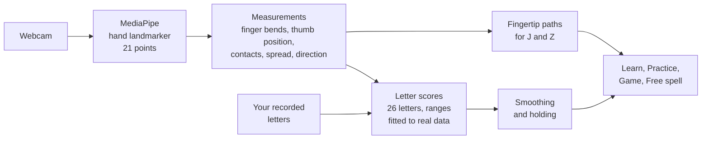

# Developing Handspell

How the recognition works in detail, how well it does, and how to rebuild the data it ships with. For running the app, see the [README](../README.md).

- [Code layout](#code-layout)
- [How ASL recognition works](#how-asl-recognition-works)
- [How ISL recognition works](#how-isl-recognition-works)
- [The reference hand](#the-reference-hand)
- [Accuracy](#accuracy)
- [Rebuilding the data](#rebuilding-the-data)
- [Tools](#tools)

## Code layout

The app is plain ES modules with no build step and no runtime dependencies beyond MediaPipe, which loads from a CDN.

| Path | What it does |
| --- | --- |
| `src/main.js` | Camera, main loop, alphabet switch, settings drawer, mode switching |
| `src/tracking/mediapipe.js` | Loads the MediaPipe hand landmarker (GPU, with a CPU fallback) |
| `src/tracking/face.js` | Face detector, used only for the ISL letter I |
| `src/sign/features.js` | ASL: turns 21 hand points into about 25 handshape measurements |
| `src/sign/letters.js`, `tuned.js` | ASL letter definitions and their fitted ranges |
| `src/sign/recognizer.js`, `hints.js`, `motion.js` | ASL scoring, advice, and the J and Z movements |
| `src/sign/live.js` | ASL frame-by-frame pipeline: smoothing, holding, best guess |
| `src/sign/isl/features.js` | ISL: measurements of two hands and how they touch |
| `src/sign/isl/letters.js`, `hints.js` | ISL letter descriptions and advice |
| `src/sign/isl/examples.js` | ISL built-in example handshapes (generated) |
| `src/sign/isl/matcher.js`, `live.js` | ISL matching and frame-by-frame pipeline |
| `src/hand3d/render.js`, `stage.js` | The reference hand renderer and its animated stage |
| `src/hand3d/poses.js`, `isl-poses.js` | Reference poses for each letter (generated) |
| `src/modes/` | Learn, Practice, Read, Game, Free spell |
| `src/ui/store.js`, `sound.js` | Saved settings and progress (local storage), sounds and speech |
| `src/data/words.js` | Word lists |
| `tools/` | Data preparation, fitting, evaluation, pose building and chart pages |

Both live pipelines share one interface (`update`, `accepts`, `best`, `templateOf`, `hintFor`, `setTemplates`, `setStrictness`, `reset`), so the modes don't need to know which alphabet is in use. The ISL code is loaded the first time ISL is chosen.

## How ASL recognition works



1. **Tracking.** MediaPipe's hand landmarker finds 21 points on the hand in each video frame, on the device.
2. **Measurements** (`features.js`). The points become about 25 numbers describing the handshape in the hand's own frame, so position, size on screen and which hand is used don't matter: how bent each finger is, where the thumb sits and whether it is in front of the fingers, which fingertips touch, how far the fingers spread or cross, and which way the hand points. MediaPipe sometimes mistakes a left hand for a right one when the hand is side-on; fingers only curl towards the palm, so the direction they bend reveals the palm side and the measurements correct themselves.
3. **Letters** (`letters.js`, `recognizer.js`). Every letter is described by the same measurements, with extra weight on the ones that define it. Some letters have two variants (M and N with the fingers draped over the thumb, or curled into a fist). The acceptable range of every measurement was fitted to landmark data from three public collections. A hand scores each letter by how well it fits; when it misses, the measurement that is furthest off becomes the advice (`hints.js`).
4. **Over time** (`live.js`, `motion.js`). Scores are smoothed over a few frames, and a letter counts once it has been held. J and Z follow a fingertip and look for the letter's shape in its path. In Practice and Free spell, a repeated letter needs a small slide or release.
5. **Your letters.** *Teach it my letter* stores a few measurements of your own handshape. A close match to one of them lifts that letter's score.

## How ISL recognition works

1. **Two hands** (`isl/features.js`). With both hands in view, it measures how they relate: the distance between every pair of fingertips, fingertips on the other palm, crossed fingers, fists stacked one above the other, and the shape of each hand. Distances are in palm lengths.
2. **Matching examples** (`isl/matcher.js`, `isl/examples.js`). The measurements are compared with about 3,400 example handshapes from three public ISL photo collections, at most 60 per letter from each, so no collection's few signers dominate. The closest examples vote, and contacts count more than anything else. The signer's own examples are blended in letter by letter and count for more.
3. **Both ways round** (`isl/live.js`). Each picture is measured as seen and mirrored, and every letter keeps its better score, so either hand can lead. MediaPipe's left and right labels are not used for this, because they flip when the back of the hand faces the camera.
4. **One hand or two.** Two touching hands are hard to track, so in ISL the tracker uses lower detection thresholds. If one of two hands vanishes while the other stays put, it is assumed to be where it was for up to half a second. A two-hand letter can still be recognised from one hand, but less readily, and when a two-hand letter is asked for with only one hand in view, the app says so instead of guessing.
5. **The face, for I** (`src/tracking/face.js`). MediaPipe's small face detector runs on every third frame. A fingertip just under an eye settles I.
6. **Adapting.** The two-minute setup records every letter once. After that, every letter signed right in Learn or Practice, when it was the clear top match, is kept as one more example (the newest 12 per letter are kept).

## The reference hand

- **ASL** (`tools/poses.mjs`): each letter's shape is the median of hundreds of real landmark sets, rotated so the letter reads clearly.
- **ISL** (`tools/isl-poses.py`): for each letter, a clear and typical photo was chosen by eye. An anatomical hand model (fixed bone lengths, joints that only bend the way fingers do) is fitted to each hand's landmarks, which gives clean shapes even where a finger was hidden. Near-contacts are closed, and letters built on an upright index finger (D, K, P, Q, T) are turned so it stands straight.

Both are drawn by `render.js` with outlined, depth-sorted strokes on a 2D canvas, with no 3D library. In ISL the hand behind is drawn paler. Between letters, the stage eases from one shape to the next, which is how Read mode fingerspells whole words.

## Accuracy

All figures are for single photos of signers left out of the fitting. In the app, a letter is judged over several frames and has to be held, which helps.

### ASL

| Test set | Exact letter | In the top three | Right letter accepted | Closest wrong letter accepted |
| --- | --- | --- | --- | --- |
| ASL Alphabet Test photos (706) | 83% | 97% | 84% | 16% |
| Surrey signers D and E (23,167 frames) | 59% | 86% | 62% | 44% |

"Accepted" uses the normal checking level. The Surrey frames are low-resolution (hands about 100 pixels across), so their landmarks are noisy; a webcam hand is usually several times larger, so the first row is closer to what to expect. The hardest letters are the closed fists (A, E, M, N, S, T) and P and Q, which point down and are seen end-on. For comparison, the neural network in the paper the data comes from reaches about 89% on the same test photos.

### ISL

Examples from two of the three collections, tested on the third; then a few photos of each letter from the test collection were added as own examples, and the rest were tested.

| Tested on | No own examples | 1 per letter | 3 per letter | 5 per letter |
| --- | --- | --- | --- | --- |
| Mendeley: 4 signers, 1280-pixel photos (452) | 59% (76%) | 76% (91%) | 89% (95%) | 94% (97%) |
| RealSign: 4 signers, small photos (5,224) | 51% (71%) | 58% (73%) | 72% (84%) | 79% (89%) |

Exact letter, with the share in the top three in brackets. The third collection (100-pixel photos of many signers) scores 36% (50%) without own examples; its photos are too small for clean landmarks, and its own examples come from a mix of people, so they help little there. A webcam picture of your own hands is closest to the first row.

Where recognition fails without setup:

- **One hand lost.** With both hands seen, A was recognised in all of the Mendeley photos and 93% of the RealSign ones. When the tracker found only one of the two fists, it was usually taken for a one-hand letter (I, S or T). This is why the tracker looks harder for a second hand and holds on to one lost for a moment.
- **Letters against an open palm** (H, M, N, R and W) are mixed up with each other, as are E and K (fingertip contacts) and G and A (fists).

Other kinds of model trained on the same measurements (boosted trees, a small neural network) gained at most five points, so the limit is how differently people sign and how few signers the collections have, not the matching method.

## Rebuilding the data

Everything under `tools/data/` is ignored by git; download the source data yourself.

### ASL

```bash
git clone --depth 1 https://github.com/rameshponnala-blip/Hand-Landmark
python3 tools/prepare-data.py Hand-Landmark/data/landmarks     # needs pandas
HOLDOUT=T,D,E node tools/tune.mjs && HOLDOUT=D,E node tools/evaluate.mjs
node tools/tune.mjs        # fit on everything again (what ships)
node tools/poses.mjs       # rebuild the reference hand shapes
```

### ISL

Download [RealSign](https://github.com/RealSign62/RealSign-Indian-Sign-Language-Dataset), the [multimodal ISL dataset](https://doi.org/10.17632/2tj6c7pzfk.2) and the [ISL image dataset](https://github.com/ayesha-hannure/Indian-Sign-Language-dataset), and the [hand landmarker model](https://storage.googleapis.com/mediapipe-models/hand_landmarker/hand_landmarker/float16/1/hand_landmarker.task). Then:

```bash
pip install mediapipe numpy scipy pillow
python3 tools/isl-extract.py RealSign/Training tools/data/isl/realsign-train.jsonl --model hand_landmarker.task
python3 tools/isl-extract.py RealSign/Testing tools/data/isl/realsign-test.jsonl --model hand_landmarker.task
python3 tools/isl-extract.py Mendeley/Dataset/English/RGB tools/data/isl/mendeley.jsonl --model hand_landmarker.task
python3 tools/isl-extract.py dataset_ISL tools/data/isl/ayesha.jsonl --model hand_landmarker.task --upscale 320
node tools/isl-build.mjs      # writes src/sign/isl/examples.js
python3 tools/isl-poses.py    # writes src/hand3d/isl-poses.js
```

- The ISL image dataset's folders are lower-case letters; rename them to capitals first.
- For the Mendeley collection, leave out the images its `manifest.csv` marks as padded duplicates.
- To change which photo a letter is drawn from, edit `PICK` in `tools/isl-poses.py`.

## Tools

| Tool | What it does |
| --- | --- |
| `tools/prepare-data.py` | ASL: turns the published landmark CSVs into `tools/data/samples.json` |
| `tools/tune.mjs` (`npm run tune`) | ASL: fits the letter ranges into `src/sign/tuned.js` |
| `tools/evaluate.mjs` (`npm run evaluate`) | ASL: accuracy on held-out signers |
| `tools/poses.mjs` (`npm run poses`) | ASL: builds `src/hand3d/poses.js` |
| `tools/isl-extract.py` | ISL: runs MediaPipe over a photo folder and writes landmarks |
| `tools/isl-build.mjs` (`npm run isl`) | ISL: builds `src/sign/isl/examples.js` |
| `tools/isl-poses.py` (`npm run isl-poses`) | ISL: fits the hand model and builds `src/hand3d/isl-poses.js` |
| `tools/alphabet-chart.html`, `tools/isl-chart.html` | Draw the alphabet charts in `docs/images` (serve the folder, open, screenshot) |
